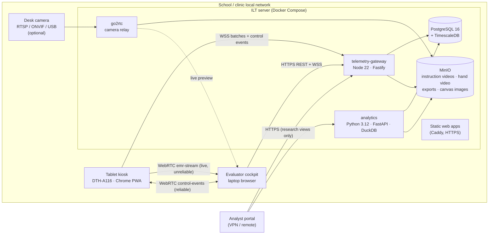

# ILT Research System: System Architecture (v5.6)

| | |
|---|---|
| **Document ID** | ILT-ARCH-SPEC-V5.6-EN |
| **Date** | 2026-10-28 |
| **Supersedes** | Architecture v5.5 (and v5.3, whose subsystem descriptions are carried forward here) |
| **Functional baseline** | [FRS v3.5](../01_Requirements/ILT_Functional_Requirements_Specification_v3.5_EN.md) |
| **Detailed design** | [DDD v1.6](../03_Detailed_Design/ILT_Detailed_Design_Specification_v1.6_EN.md). **The database DDL lives only in the DDD** (earlier editions kept two copies, which drifted apart) |
| **Device** | Wacom DTH-A116 (Android 14, Chrome). Measured: 240 Hz design rate, 0.1 ms timing, 5.195 CSS px/mm |

---

## 1. Principles

1. **Raw data first.** Every pen sample and every per-letter measure is stored; scores are derived, versioned and recomputable.
2. **Everything clinical is a setting.** No clinical number is hard-coded; each setting has a System value with an optional Domain override (scoring, language) or Region override (ILT process), and settings are snapshotted per session.
3. **One scoring implementation.** A pure TypeScript package used by the server (authoritative), the cockpit (live preview) and reference recordings.
4. **Works offline on a school network.** No internet is needed during a session.
5. **Privacy by design.** No identity data; research data reachable only through research views; video off by default.
6. **Multi-lingual and RTL from the first screen.**
7. **Everything is logged** in one structured, searchable event log.
8. **Open source only.**

## 2. Deployment topology (POC)

- **POC:** one ILT server per site (a mini PC or laptop running Docker), reachable over HTTPS on the local network. The analyst portal reaches it over a VPN.
- **Later (not in the POC):** several site servers replicate de-identified research data to a central research server. The schema already supports this (UUID keys, immutable samples, versioned scores).

## 3. Components

| Component | Technology | Responsibilities |
|---|---|---|
| **tablet-kiosk** | React 18, Vite, PWA, Canvas 2D | Pairing (6-digit PIN), true-size canvas rendering, pen capture from `pointerrawupdate`, palm rejection, forward-only box locking, inactivity cue, local IndexedDB buffer, binary encoding, reference-recording mode, child-language UI |
| **evaluator-cockpit** | React 18, Vite | Session planning, live mirror (80%) + clinical telemetry (20%), step dispatch, pause/repeat/abort, paper-page timer, intervention marking, comparative summary with replay; **administration** screens for the System Administrator (settings, canvases, reference recordings, users, organisation, log search) |
| **analyst-portal** | React 18, Vite | Research-only replay, kinematic plots, cohort slicing, export requests |
| **telemetry-gateway** | Node 22, Fastify, `ws`, `pg`, zod, pino | REST API, WebSocket hubs, WebRTC signalling, packet decoding and CRC check, idempotent sample persistence, block integrity check, **scoring** via `ilt-metrics`, settings resolution and snapshots, RBAC, director-PIN check, application log writer |
| **analytics** | Python 3.12, FastAPI, DuckDB, NumPy/SciPy, pyarrow | Kinematics (resampling, velocity, jerk), Parquet/CSV exports from research views, legacy XLS import, letter-sheet dot measurement tooling |
| **PostgreSQL 16 + TimescaleDB** | | All data: organisation, settings, canvases, sessions, raw samples (hypertable), scores, log (hypertable) |
| **MinIO** | S3-compatible | Instruction videos (per key and language, served to the tablet on the local network), recorded hand video, canvas background images, export files (private bucket, signed URLs) |
| **go2rtc** | | Camera ingestion (RTSP/ONVIF/USB) for optional desk video |
| **Caddy** | | Serves the three web apps; HTTPS with a local CA |

Shared packages: `shared-types`, `emr-protocol`, `ilt-metrics`, `template-schemas`, `i18n`, `ui` (DDD §3).

## 4. Data flows

### 4.1 Live session

1. The evaluator creates a session: participant, language, purpose, protocol template. The gateway resolves all settings for the participant's Domain/Region and stores the **settings snapshot**.
2. The cockpit opens a room; the tablet pairs with the 6-digit PIN. The tablet's calibration (px/mm) is copied onto the session.
3. For each step, the cockpit sends `DISPATCH_STEP` with the **resolved canvas** (language's canvas, mirroring applied, fill order, timers).
4. While the child writes, every `pointerrawupdate` sample goes two ways:
   - **Live:** `LIVE` packets over the WebRTC `emr-stream` channel straight to the cockpit (target < 15 ms; loss is tolerable).
   - **Persistent:** buffered in IndexedDB, sent as `BATCH` packets (≤ 50 samples) over WSS to the gateway, kept until ACKed. The gateway inserts with `ON CONFLICT DO NOTHING` on `(block_attempt_id, sample_seq, sample_time)`.
5. At `BLOCK_COMPLETE`, the gateway waits for the last `sample_seq`, verifies the SHA-256, segments letters, stores **raw letter measures**, computes **score version 1** with the snapshot, and sends `BLOCK_SCORED` to the cockpit.
6. For intervention sheets, the cockpit shows the suggested marks; evaluator changes are stored with who made them.

### 4.2 Replay

The cockpit's Comparative Summary and the analyst portal fetch samples as binary (`GET /block-attempts/:id/samples`), plus letter measures and scores. The replayer redraws the mirrored canvas on a timeline (0.25×–4×), shows speed per house, and syncs video from MinIO when present. Access is filtered by role and purpose in the gateway.

### 4.3 Recomputation

The System Administrator selects blocks and a set of settings; the gateway re-runs `ilt-metrics` on stored raw data and writes a new `score_versions` row (the previous one is kept, `is_current` moves). Logged as `scores.recomputed`.

### 4.4 Research export

Analysts request an export; the analytics service reads **only** `v_research_*` views with the `ilt_analyst` database role, writes Parquet/CSV to a private MinIO bucket, and returns a 15-minute signed URL. Logged as `data.export.created`.

### 4.5 Reference recordings

The administrator pairs a tablet in `REFERENCE` mode from the canvas screen. The tablet captures as usual; the gateway runs the same segmentation and scoring code, shows the derived fill order, pen-lift count or Normal speed, and on **[Accept]** writes them into the canvas scoring profile (system default or a Domain override). **[Clear]** keeps the recording for audit but never uses it.

## 5. Cross-cutting design

### 5.1 Settings service (in the gateway)

- Catalogue in `setting_definitions` (type, range, default, `override_scope`, approval flag, Hebrew and English descriptions).
- Values in `setting_values` per scope; every change also goes to `setting_value_history` and the log.
- Domain (a student-grouping category) and Region (a geographic area) are independent dimensions. Scoring factors and language configuration can be overridden per Domain; ILT-process settings per Region. Otherwise the System value or default applies (FRS §3).
- Canvas scoring profiles: canvas default, deep-merged with a Domain override.
- Writes only by `ADMIN`; clinically governed keys also need a Research Director PIN when `governance.require_director_approval` is on.
- Snapshot per session; scoring never reads live settings.

### 5.2 Canvas library

- Canvases are JSON documents validated against `template-schemas`, with optional background images in MinIO. Versioned; only one Active version per code.
- Grouped Language → Set (ILT / Notebook / Intervention letters) → Canvas. The per-language settings pick the canvases used by protocol templates.
- Mirroring and fill order are applied when the gateway resolves a canvas for dispatch; the stored canvas never changes.

### 5.3 Internationalisation and RTL

- All three apps use `i18next` with `he` and `en` files from `packages/i18n`; missing keys fail CI.
- Document direction follows the interface language; components use CSS logical properties only (enforced by lint), so one layout serves both directions.
- The child's language (session) and the evaluator's language (user preference) are independent.
- Server messages are codes (`message_key`), translated in the client. The log stores English text for search and shows translated labels.
- The writing canvas is rendered in physical millimetres and is never affected by `dir`.

### 5.4 Application log

- Each service writes structured JSON lines (pino) to stdout **and** to the `app_events` hypertable (batched within 1 s).
- Client apps send their events through the gateway.
- Fixed event vocabulary (`area.object.action`), common fields (actor, role, device, domain, region, session, entity, correlation id), JSON details, full-text index.
- Append-only: the application's database role has no UPDATE/DELETE on the log.
- Search screen for the System Administrator; retention by policy (default 5 years).

### 5.5 Security and privacy

- HTTPS/WSS everywhere (local CA); WebRTC DTLS.
- argon2id for passwords and PINs; director PIN verified on the server; lockout after 5 failures.
- JWT access tokens (15 min) and refresh tokens (8 h); role checks on every route.
- No identity data; school codes as keyed HMAC (key in the environment).
- Research separation enforced twice: in the gateway (purpose/role checks) and in the database (analyst role sees only research views).
- Video only with setting **and** consent.

### 5.6 Reliability

- Tablet buffer survives network loss and page reloads; batches are idempotent.
- Per-block SHA-256 over the sample bytes; mismatches are logged and flagged on the block.
- Heartbeats every 2 s; the cockpit shows link state; sessions resume after reconnection.
- Database backups nightly (`pg_dump` + MinIO mirror) to an external disk.

## 6. Performance budget

| Item | Budget |
|---|---|
| Live mirror latency (tablet → cockpit render) | < 15 ms on the LAN |
| Sample rate | 240 Hz sustained, 270 Hz peak |
| Telemetry volume | ~240 rows/s per tablet, ~7,200 rows per 30 s block, ~5.8 KB/s on the wire |
| Block scoring | < 500 ms after the last sample arrives |
| Replay start | < 2 s for one block |
| Concurrent tablets per site server | 4 (POC), tested with the mock stylus |

## 7. Technology versions

| Item | Version |
|---|---|
| Node.js | 22 LTS, pnpm 9, Turborepo |
| React | 18.3 |
| Python | 3.12 |
| PostgreSQL | 16 with TimescaleDB 2.x (`timescale/timescaledb:latest-pg16`) |
| MinIO | Current release (image availability checked at Phase 0) |
| Browser on tablet | Chrome (Android 14) with `pointerrawupdate` |
| Dev environment | Windows 11 + Docker Desktop (WSL2) |

## 8. Environments

| Environment | Where | Data |
|---|---|---|
| Development | Docker Compose on the developer PC; mock stylus | Seeded dev data only |
| Test | Same compose file on the site server hardware, with a real DTH-A116 | Synthetic and staff recordings |
| Pilot | Site server at the school, purpose `INTERVENTION` by default | Real sessions; research views empty until research approval |

## 9. Changes from v5.5

| Area | Change |
|---|---|
| DDL | Removed from this document; the DDD is the single source |
| New subsystems | Settings service with scopes and snapshots; canvas library with reference recordings; application log; i18n/RTL |
| Scoring | Moved into one shared TypeScript package used by gateway and cockpit; analytics does kinematics and exports only |
| Data | Raw letter measures separated from versioned scores; samples keyed and partitioned by sample time; raw pressure |
| Replay | Available to evaluators from the Comparative Summary, not only to analysts |
| Privacy | Identity table removed; research views and a separate analyst database role |
| Device | Named DTH-A116 only |
