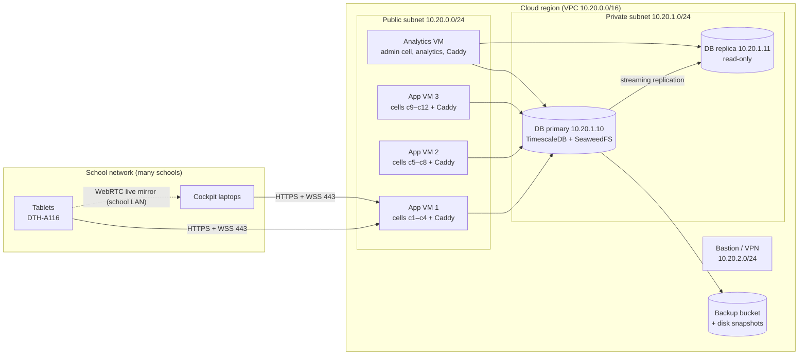

# ILT Research System: System Installation Guide (Cloud), v1.0

| | |
|---|---|
| **Document ID** | ILT-INSTALL-GUIDE-V1.0-EN |
| **Date** | 2026-11-02 |
| **Applies to** | ILT Research System release after Phase 2 (gateway 0.1.0), repository `yakig1-sketch/ILT_Project_2026` |
| **Related documents** | [FRS v3.5](../01_Requirements/ILT_Functional_Requirements_Specification_v3.5_EN.md), [Architecture v5.6](../02_System_Architecture/ILT_System_Architecture_and_Specifications_v5.6_EN.md), [DDD v1.6](../03_Detailed_Design/ILT_Detailed_Design_Specification_v1.6_EN.md) |
| **Target load** | 100–500 concurrent evaluation sessions, 10–20 concurrent analytics users |
| **Audience** | IT administrator / DevOps engineer installing and operating the system; project owner approving the installation |

---

## 1. Introduction

### 1.1 Purpose

This guide specifies the hardware, software and networking needed to run the ILT Research System in a public cloud for **100 to 500 concurrent evaluation sessions** and **10 to 20 concurrent analytics users**, and gives a step-by-step installation and operations manual.

### 1.2 What changes when the system moves to the cloud

Architecture v5.6 describes a proof-of-concept with one server per school on the local network. A cloud installation changes three things that the project owner should be aware of:

1. **Schools need internet during sessions.** Architecture principle 4 ("works offline on a school network") no longer holds. The tablet still keeps every pen sample in its local buffer until the server confirms it, so a short internet outage does not lose data, but videos, pairing and the live mirror need the connection.
2. **One central installation serves all schools**, organised in **cells** (section 2.3). A school is assigned to one cell.
3. **Children's research data are stored in a cloud data centre.** This needs approval before go-live (section 7).

The Architecture document should be updated (v5.7) once the owner decides on cloud hosting.

### 1.3 Terms

| Term | Meaning |
|---|---|
| **Evaluation session** | One child, one tablet (DTH-A116) and one evaluator cockpit (laptop browser) connected at the same time |
| **Cell** | One `telemetry-gateway` process with its own hostname (for example `c3.ilt.example.org`). All tablets and cockpits of a school use the same cell. All cells share one database and one S3 storage |
| **App VM** | A virtual machine running four cells and the Caddy web front |
| **Primary / replica** | The PostgreSQL + TimescaleDB database server, and its streaming read-only copy |
| **Ops container** | The server image used for database tools: migrations, reference-data seed, user accounts |

### 1.4 Status of this release

The installation files in `infra/cloud/` were built and tested on 2026-11-02 in a local Docker environment. That test covered:

- the image builds;
- database migration and seed;
- creating the first administrator;
- four cells behind Caddy;
- login, tablet pairing, intro video and stored pen samples through a cell;
- streaming replication to a read replica;
- the TimescaleDB tuning commands;
- the analytics VM stack.

Two things were **not** tested: Let's Encrypt certificates (they need public DNS), and the capacity figures under real load. **Section 10 lists the actions required before production.**

---

## 2. System overview

### 2.1 Components

| Component | Technology | Runs on | Role |
|---|---|---|---|
| tablet-kiosk | React 18 web app | DTH-A116 tablet, Chrome | Pen capture, true-size canvas, videos, local sample buffer |
| evaluator-cockpit | React 18 web app | Evaluator laptop, Chrome/Edge | Session control, live mirror, scores, summary, replay, administration |
| analyst-portal | React 18 web app | Analyst workstation | Research replay, cohorts, exports (frame only in this release) |
| telemetry-gateway | Node.js 24, Fastify | App VMs (one process per cell) | REST API, WebSocket hub, pen-sample persistence, scoring, settings, log |
| analytics | Python 3.12, FastAPI, DuckDB | Analytics VM | Kinematics and research exports (health endpoint only in this release) |
| Database | PostgreSQL 16.15 + TimescaleDB 2.31.0 | DB primary + replica VMs | All data; pen samples in a compressed hypertable |
| S3 storage | SeaweedFS 4.50 | DB primary VM | Instruction videos, canvas images, hand video, export files |
| Web front | Caddy 2.10 | App VMs, analytics VM | HTTPS (Let's Encrypt), static web apps, reverse proxy to the cells |

### 2.2 Cloud topology



### 2.3 Why cells

The gateway keeps each live session's room (the tablet, its cockpits and the block in progress) in the memory of the process that serves it. The tablet and the cockpit of one session must therefore reach the **same gateway process**. In this release, the session is identified only inside the first WebSocket message, so a load balancer cannot route by session.

The installation therefore splits the load into cells:

- Each cell has its own hostname, and Caddy sends that hostname to one gateway process.
- A school is assigned to one cell, and its evaluators and tablets always use that cell's address.
- Cells share the database, so any user can sign in on any cell, and results are visible everywhere.

### 2.4 Addresses used by schools and staff

| Who | Address |
|---|---|
| Tablet of a school in cell *N* | `https://cN.ilt.example.org/tablet/` |
| Evaluator of a school in cell *N* | `https://cN.ilt.example.org/cockpit/` |
| Researchers (summary, replay) | `https://research.ilt.example.org/cockpit/` |
| System Administrator (users, Domains, Regions, settings) | `https://research.ilt.example.org/cockpit/admin` |
| Analysts | `https://research.ilt.example.org/analyst/` |

`ilt.example.org` stands for the organisation's real domain throughout this guide.

---

## 3. Capacity planning

### 3.1 Workload assumptions

| Item | Value | Source |
|---|---|---|
| Pen sample rate | 240 Hz sustained, 270 Hz peak, while the pen is in range | Architecture §6 |
| Wire volume per writing tablet | ≈ 5.8 KB/s (batches of up to 50 samples) | Architecture §6 |
| Day 1 session | Intro video, warm-up, 8 ILT blocks, notebook video, 4 notebook pages: 13 writing blocks, ≈ 40–45 min | FRS §5 |
| Day 2 / Day 14 session | 4 / 2 ILT blocks on the tablet | FRS §5 |
| Pen in range during a session | ≈ 25–40 % of the session time | Estimate |
| Rows per Day 1 session | ≈ 120,000 pen samples | 13 blocks × ≈ 9,000 |
| Stored size per row | ≈ 150 bytes uncompressed (row + primary-key index); ≈ 10–15 bytes compressed | Estimate for the DDD schema |
| Instruction videos | 2.7 MB (intro) + 6.0 MB (notebook demo) per Day 1 session | Measured |
| Scoring | < 500 ms per block, inside the gateway | Architecture §6 |

### 3.2 Load at 500 concurrent sessions

| Quantity | Peak (everyone writing) | Average (40 % writing) |
|---|---|---|
| Pen samples inserted | 120,000–135,000 rows/s | ≈ 48,000 rows/s |
| Insert statements (50-row batches) | ≈ 2,700 /s | ≈ 1,000 /s |
| Inbound sample traffic | ≈ 23 Mbit/s | ≈ 10 Mbit/s |
| WAL generated on the primary | ≈ 30 MB/s | ≈ 12 MB/s |
| Blocks scored | ≈ 10 /s | ≈ 4 /s |

Two mechanisms make short peaks safe:

- The tablet keeps every batch until the gateway confirms it.
- Inserts are idempotent.

So a short overload delays confirmations but never loses samples. The design point is the peak, with headroom.

### 3.3 Storage growth

| Scenario | Sessions per school day | Raw ingest per day | After compression per day | Per year (200 school days) |
|---|---|---|---|---|
| 100 concurrent, 4 rounds/day | 400 | ≈ 7 GB | ≈ 0.6 GB | ≈ 120 GB |
| 250 concurrent, 4 rounds/day | 1,000 | ≈ 18 GB | ≈ 1.5 GB | ≈ 300 GB |
| 500 concurrent, 4 rounds/day | 2,000 | ≈ 36 GB | ≈ 3 GB | ≈ 600 GB |

- **Hot data:** compression runs on chunks older than 3 days (section 8.8). Uncompressed data is therefore about 3–4 days of raw ingest: ≈ 150 GB at 500 concurrent.
- **Not included above:** indexes on other tables, the application log, and WAL. Allow a factor of 1.5 for these.
- **Hand video:** off by default. If it is enabled, add about 50–100 MB per session to the S3 storage.

### 3.4 Cell capacity

- **Planning figure: 50 concurrent sessions per cell.** Each cell gets 2 vCPU and 2 GB RAM.
- **Margin:** at 50 sessions, a cell handles about 270 inserts/s and scores about one block per second. That leaves margin on one Node.js event loop.
- **Not yet measured.** The POC measured only 4 tablets. The figure must be confirmed by the load test in section 10 before more than 4 cells go live.

| Concurrent sessions | Cells needed (+20 % headroom) | App VMs (4 cells each) |
|---|---|---|
| 100 | 3 | 1 |
| 250 | 6 | 2 |
| 500 | 12 | 3 |

### 3.5 Analytics users

Ten to twenty concurrent analysts and administrators use:

- the admin cell on the analytics VM, for replay, summaries, settings and the log;
- the analytics service, for exports and kinematics.

The analytics service reads only the research views, and only on the **read replica**, so analysis never slows down live sessions. An export job can use 2–4 cores and up to 8 GB RAM for a few minutes. The analytics VM is sized for 3–4 such jobs at once.

---

## 4. Hardware requirements

### 4.1 Cloud virtual machines (500 concurrent sessions)

| Role | Qty | vCPU | RAM | Disks | AWS example | Azure example | Google Cloud example |
|---|---|---|---|---|---|---|---|
| App VM (4 cells + Caddy) | 3 | 8 | 16 GB | 64 GB OS SSD | c7i.2xlarge | F8s v2 | c3-highcpu-8 |
| DB primary (TimescaleDB + SeaweedFS) | 1 | 16 | 64 GB | 64 GB OS; **2 TB data SSD, ≥ 16,000 IOPS, ≥ 500 MB/s**; 500 GB S3 data SSD | m7i.4xlarge + gp3 | D16s v5 + Premium SSD v2 | n2-standard-16 + Hyperdisk Balanced |
| DB replica (read-only, failover target) | 1 | 16 | 64 GB | Same as primary (no S3 disk) | m7i.4xlarge + gp3 | D16s v5 + Premium SSD v2 | n2-standard-16 + Hyperdisk Balanced |
| Analytics VM | 1 | 8 | 32 GB | 64 GB OS; 500 GB SSD for export scratch | m7i.2xlarge | D8s v5 | n2-standard-8 |
| Bastion / VPN (or a managed bastion service) | 1 | 2 | 4 GB | 32 GB | t3.medium | B2s | e2-medium |

All VMs are x86-64.

**Smaller loads:**

| Concurrent sessions | App VMs | DB primary and replica | DB data disk |
|---|---|---|---|
| 100 | 1 | 8 vCPU / 32 GB each | 1 TB |
| 250 | 2 | 16 vCPU / 64 GB each | 1.5 TB |
| 500 | 3 | 16 vCPU / 64 GB each | 2 TB |

At 500 sessions, move the database to 32 vCPU / 128 GB if the load test shows sustained database CPU above 60 %.

### 4.2 Backup storage

- **Disk snapshots:** daily snapshots of the DB primary data disks, kept 14 days, plus weekly snapshots kept 8 weeks.
- **Object-storage backup bucket:** private, versioned, in the same region, with a copy in a second region if policy requires. Expect about 3× the compressed database size.

### 4.3 Client devices at the school

| Device | Requirement |
|---|---|
| Tablet | Wacom DTH-A116, Android 14, current Chrome, charger at the desk |
| Evaluator laptop | Windows 10/11 or macOS, current Chrome or Edge, 8 GB RAM, screen ≥ 1920 × 1080 (minimum 1366 × 768), Wi-Fi 5 or wired |
| Pen | DTH-A116 pen; spare nibs |

---

## 5. Software requirements

### 5.1 Server software

| Item | Version | Where |
|---|---|---|
| Operating system | Ubuntu Server 24.04 LTS, x86-64 | All VMs |
| Docker Engine | 28 or later, with Buildx | All VMs |
| Docker Compose plugin | 2.24 or later | All VMs |
| Git and Git LFS | Current Ubuntu packages | All VMs (LFS needed on the build host only) |
| Container registry | Provider registry (Amazon ECR, Azure Container Registry, Google Artifact Registry) | Cloud account |

### 5.2 Container images

| Image | Built from / version | Used on |
|---|---|---|
| `ilt-server:<version>` | `infra/cloud/ilt.Dockerfile`, target `server` (Node 24, gateway and database tools) | App VMs, analytics VM |
| `ilt-web:<version>` | Same file, target `web` (Caddy 2.10 with the three built web apps) | App VMs, analytics VM |
| `ilt-analytics:<version>` | Same file, target `analytics` (Python 3.12) | Analytics VM |
| `timescale/timescaledb:2.31.0-pg16` | Docker Hub | DB primary and replica |
| `chrislusf/seaweedfs:4.50` | Docker Hub | DB primary |

### 5.3 Why the database and storage are self-managed

- **Database:** pen-sample compression and the compression policies are TimescaleDB Community features (Timescale License). Self-hosting may use them. Managed PostgreSQL services (Amazon RDS, Azure Database for PostgreSQL, Cloud SQL) either do not offer TimescaleDB or offer only its Apache edition without compression. Without compression, storage would grow 10–15 times faster. The installation therefore runs the official TimescaleDB image on a VM. Timescale's own managed cloud is an alternative if it is available in the chosen region.
- **Storage:** the gateway and the seed use a fixed bucket name (`ilt`) and a fixed signing region. That works with SeaweedFS but not with Amazon S3 or Google Cloud Storage, where bucket names are global. SeaweedFS therefore runs on the DB primary. Making the bucket and region configurable is listed in section 10.

### 5.4 Client software

| Client | Requirement |
|---|---|
| Tablet | Chrome (current) on Android 14. The site must be HTTPS: the browser needs a secure context for pen capture (`pointerrawupdate`), Web Crypto and unique IDs. A Let's Encrypt certificate means nothing has to be installed on the tablets |
| Cockpit | Chrome or Edge (current). Hebrew and English interface |

---

## 6. Network requirements

### 6.1 Cloud network

| Subnet | CIDR | Contents | Internet access |
|---|---|---|---|
| Public | 10.20.0.0/24 | App VMs (10.20.0.11–13), analytics VM (10.20.0.20) with public IPs | Inbound 80/443 only |
| Private (data) | 10.20.1.0/24 | DB primary 10.20.1.10, DB replica 10.20.1.11 | Outbound only (NAT), for updates and backups |
| Management | 10.20.2.0/24 | Bastion / VPN endpoint | Inbound SSH or VPN from the admin's address only |

**Region:** choose the region closest to the schools. For schools in Israel, use an Israeli region for latency and data residency: AWS il-central-1 (Tel Aviv), Azure Israel Central, or Google Cloud me-west1 (Tel Aviv).

### 6.2 Firewall rules (security groups)

| # | From | To | Port | Purpose |
|---|---|---|---|---|
| 1 | Internet | App VMs, analytics VM | TCP 443, UDP 443 | HTTPS, WSS, HTTP/3 |
| 2 | Internet | App VMs, analytics VM | TCP 80 | Let's Encrypt HTTP-01 challenge, redirect to HTTPS |
| 3 | App VMs, analytics VM | DB primary | TCP 5432 | Database (gateway, database tools) |
| 4 | App VMs, analytics VM | DB primary | TCP 8333 | S3 storage (videos, exports) |
| 5 | Analytics VM | DB replica | TCP 5432 | Research views (read-only) |
| 6 | DB replica | DB primary | TCP 5432 | Streaming replication |
| 7 | Bastion | All VMs | TCP 22 | Administration (SSH) |
| 8 | All VMs | Internet (via NAT) | TCP 443 | Container registry, OS updates, Let's Encrypt, backup bucket |
| — | Anything else | Any VM | — | **Deny** |

Ports 5432 and 8333 bind only to the private address of the DB VMs, and are never exposed to the internet.

### 6.3 DNS and certificates

| Record | Type | Value |
|---|---|---|
| `c1` … `c4.ilt.example.org` | A | Public IP of app VM 1 |
| `c5` … `c8.ilt.example.org` | A | Public IP of app VM 2 |
| `c9` … `c12.ilt.example.org` | A | Public IP of app VM 3 |
| `research.ilt.example.org` | A | Public IP of the analytics VM |

- **Before Caddy starts:** use static (elastic) public IPs and create the records before Caddy starts. Caddy obtains and renews a Let's Encrypt certificate for every hostname automatically.
- **CAA record:** if the domain has a CAA record, it must allow `letsencrypt.org`.

### 6.4 Bandwidth

| Link | Requirement |
|---|---|
| Cloud ingress/egress (all schools) | 200 Mbit/s budget at 500 sessions. Covers sample batches (≈ 23 Mbit/s), live-mirror relay when WebRTC is not possible (up to 2× more), video starts and the web apps. VM network interfaces of 10 Gbit/s are standard on the sizes above |
| DB primary → replica | Peak WAL ≈ 30 MB/s (≈ 240 Mbit/s) inside the region |
| School internet | ≥ 1 Mbit/s up **and** down per concurrent tablet, minimum 10/10 Mbit/s per school |

### 6.5 School network (each site)

1. **Latency and loss:** round-trip time to the cloud region below 100 ms (ideally below 50 ms), with packet loss below 1 %.
2. **Allow outbound HTTPS and WebSocket** (TCP 443) to `*.ilt.example.org`. Exempt these hostnames from content filtering and TLS inspection: inspecting proxies often break long-lived WebSocket connections.
3. **Live mirror (WebRTC):** the tablet and the cockpit connect directly on the school network for the < 15 ms live mirror. They have no STUN/TURN server and use local addresses. Requirements:
   - Both devices are on the same Wi-Fi network/VLAN.
   - Client isolation (AP isolation) is **off** between them.
   - Multicast DNS (mDNS, UDP 5353) is allowed: Chrome announces local addresses by mDNS name.
   - If any of these is missing, the mirror automatically falls back to relay through the cell. That works but adds internet latency and bandwidth.
4. **Wi-Fi:** 5 GHz, WPA2/WPA3, signal at the desk better than −67 dBm. Avoid captive portals on the ILT network: the tablet cannot complete them unattended.
5. **Time:** devices take time from the network automatically. Scoring uses the tablet's own clock deltas, so it is not affected.

---

## 7. Security and privacy requirements

1. **Approvals before go-live:** hosting research data about children in a public cloud needs prior approval. Obtain it from:
   - the ethics committee;
   - the organisation's data protection officer;
   - where relevant, the Ministry of Education.

   Check the requirements of the Israeli Privacy Protection (Data Security) Regulations, 2017. Record the approval in the system's ethics approvals table.
2. **No identity data:** the system stores none. School names are kept only as keyed HMAC codes. The HMAC key (`SCHOOL_CODE_HMAC_KEY`) and the token key (`JWT_SECRET`) are installation secrets.
3. **Secrets:**
   - Generate every secret randomly, with at least 48 characters for keys.
   - Keep them in the organisation's password vault or the cloud secret manager.
   - Store them on the VMs only in `chmod 600` files that are never committed.
   - `ops.env`, which holds the database owner password, exists only during installation and upgrades.
4. **Administration access:** only through the bastion or VPN, with SSH keys (no passwords), multi-factor authentication on the cloud console, and named administrator accounts.
5. **Encryption:**
   - in transit: TLS 1.2+ to the internet (Caddy), and WebRTC DTLS on the school network;
   - at rest: enable provider disk encryption on every disk and on the backup bucket.
6. **Patching:** monthly OS and image updates (section 9.3). Enable unattended security updates on Ubuntu.

---

## 8. Installation manual

### 8.1 Order of work and prerequisites

Install in this order:

1. Provision.
2. Prepare the VMs.
3. Create the secrets.
4. Build the images.
5. Set up the DB primary.
6. Run migrate and seed.
7. Tune.
8. Create the first users.
9. Set up the replica.
10. Set up the app VMs.
11. Set up the analytics VM.
12. Verify.
13. Prepare the schools.

Allow one working day for an experienced administrator.

**Prerequisites:**

- [ ] Cloud account and project/subscription, with a budget alert
- [ ] Approvals from section 7
- [ ] A domain you control, with the ability to create DNS records
- [ ] Read access to the repository and the release tag to install
- [ ] A password vault entry for the secrets in section 8.4
- [ ] A DTH-A116 tablet and a laptop for the acceptance test

### 8.2 Provision the network and VMs

1. **Network:** create the VPC/VNet `10.20.0.0/16` with the three subnets of section 6.1 and a NAT gateway for the private subnet.
2. **VMs:** create the VMs of section 4.1 with Ubuntu Server 24.04 LTS. Give them the fixed private addresses of section 6.1, and give static public IPs to the app VMs and the analytics VM.
3. **Disks:** attach the data disks:
   - DB primary: 2 TB `pg` disk and 500 GB `s3` disk;
   - replica: 2 TB `pg` disk;
   - analytics VM: 500 GB scratch disk.

   Enable encryption on every disk.
4. **Security groups:** apply the rules of section 6.2.
5. **DNS:** create the records of section 6.3.
6. **Backups:** create the backup bucket (private, versioned, encrypted) and a daily snapshot policy for the DB primary data disks (section 9.1).
7. **Container registry:** create a private registry named `ilt` in the same region.

### 8.3 Prepare every VM

Run on each VM as an administrator with `sudo`.

```bash
# System updates and tools
sudo apt-get update && sudo apt-get -y upgrade
sudo apt-get install -y ca-certificates curl git git-lfs unattended-upgrades
sudo timedatectl set-timezone UTC

# Docker Engine and the Compose plugin (official Docker repository)
sudo install -m 0755 -d /etc/apt/keyrings
sudo curl -fsSL https://download.docker.com/linux/ubuntu/gpg -o /etc/apt/keyrings/docker.asc
sudo chmod a+r /etc/apt/keyrings/docker.asc
echo "deb [arch=$(dpkg --print-architecture) signed-by=/etc/apt/keyrings/docker.asc] https://download.docker.com/linux/ubuntu $(. /etc/os-release && echo $VERSION_CODENAME) stable" | sudo tee /etc/apt/sources.list.d/docker.list
sudo apt-get update
sudo apt-get install -y docker-ce docker-ce-cli containerd.io docker-buildx-plugin docker-compose-plugin
sudo usermod -aG docker "$USER"     # log out and in again
docker version && docker compose version
```

On the **DB VMs and the analytics VM**, format and mount the data disks. Check the device names with `lsblk` first: the examples use `/dev/nvme1n1` and `/dev/nvme2n1`.

```bash
# DB primary: PostgreSQL disk and S3 disk
sudo mkfs.xfs -L iltpg /dev/nvme1n1
sudo mkfs.xfs -L ilts3 /dev/nvme2n1
sudo mkdir -p /data/pg /data/s3
echo 'LABEL=iltpg /data/pg xfs defaults,noatime,nofail 0 2' | sudo tee -a /etc/fstab
echo 'LABEL=ilts3 /data/s3 xfs defaults,noatime,nofail 0 2' | sudo tee -a /etc/fstab
sudo mount -a && df -h /data/pg /data/s3

# DB VMs: keep PostgreSQL in memory
echo 'vm.swappiness=1' | sudo tee /etc/sysctl.d/90-ilt.conf && sudo sysctl --system
```

On the replica, mount only `/data/pg`. On the analytics VM, mount the scratch disk at `/data/scratch`.

Get the installation files on every VM. Replace `<release-tag>` with the version being installed. A private repository needs a deploy key or token.

```bash
sudo mkdir -p /opt/ilt && sudo chown "$USER" /opt/ilt
GIT_LFS_SKIP_SMUDGE=1 git clone https://github.com/yakig1-sketch/ILT_Project_2026.git /opt/ilt/src
cd /opt/ilt/src && git checkout <release-tag>
```

### 8.4 Create the secrets

Generate each value with `openssl rand -base64 48 | tr -d '/+=' | cut -c1-48`, and store it in the vault before using it.

| Secret | Used in | Notes |
|---|---|---|
| `POSTGRES_PASSWORD` | DB `.env`, `ops.env` (`DATABASE_URL`) | Database owner `ilt_owner` |
| `ILT_APP_DB_PASSWORD` | `ops.env`, `ilt.env` (`APP_DATABASE_URL`) | Role `ilt_app`, used by the gateways |
| `ILT_ANALYST_DB_PASSWORD` | `ops.env`, analytics `ilt.env` | Role `ilt_analyst`, research views only |
| Replication password | Typed at the prompt (section 8.6) | Role `replicator` |
| `S3_SECRET_KEY` | DB `.env`, `ilt.env` | SeaweedFS key; access key `ilt-s3` |
| `JWT_SECRET` | `ilt.env` on all VMs | Same on every VM; changing it signs everybody out |
| `SCHOOL_CODE_HMAC_KEY` | `ilt.env` on all VMs | Same on every VM. **Never change it once participants exist**: their school codes could no longer be matched |
| First administrator password | Typed at the prompt (section 8.7) | At least 12 characters |
| Research Director PIN | Typed at the prompt (section 8.7) | 6 digits |

### 8.5 Build and publish the images (app VM 1)

App VM 1 doubles as the build host. Fetch the two instruction videos that the seed uploads:

```bash
cd /opt/ilt/src
git lfs pull --include="Documents/08_Presentations_and_Demos/ILT_Instruction_Demo_v6_No_Avatar_Hebrew_Female_VO.mp4,Documents/08_Presentations_and_Demos/ILT_in_Notebook_Demo.mp4"

export ILT_VERSION=$(git describe --tags --always)
export REG=<registry-host>/ilt          # e.g. 123456789012.dkr.ecr.il-central-1.amazonaws.com/ilt
docker build -f infra/cloud/ilt.Dockerfile --target server    -t $REG/ilt-server:$ILT_VERSION .
docker build -f infra/cloud/ilt.Dockerfile --target web       -t $REG/ilt-web:$ILT_VERSION .
docker build -f infra/cloud/ilt.Dockerfile --target analytics -t $REG/ilt-analytics:$ILT_VERSION .
```

Sign in to the registry with the provider's command, then push:

| Provider | Sign in |
|---|---|
| AWS | `aws ecr get-login-password --region il-central-1 \| docker login --username AWS --password-stdin <account>.dkr.ecr.il-central-1.amazonaws.com` |
| Azure | `az acr login --name <registry>` |
| Google Cloud | `gcloud auth configure-docker me-west1-docker.pkg.dev` |

```bash
for i in ilt-server ilt-web ilt-analytics; do docker push $REG/$i:$ILT_VERSION; done
```

The first build takes about 5 minutes. Note `ILT_VERSION`: every VM uses the same tag.

### 8.6 DB primary: database and S3 storage

```bash
cd /opt/ilt/src/infra/cloud
cp db.env.example .env && chmod 600 .env
nano .env    # DB_BIND_IP=10.20.1.10, POSTGRES_PASSWORD, S3_SECRET_KEY; keep the tuning values for 16 vCPU / 64 GB
docker compose -f compose.db.yml --profile storage up -d --wait
docker compose -f compose.db.yml ps     # db healthy, s3 running
```

Prepare streaming replication for the replica:

```bash
docker compose -f compose.db.yml exec db psql -U ilt_owner -d ilt \
  -c "CREATE ROLE replicator WITH REPLICATION LOGIN" \
  -c "SELECT pg_create_physical_replication_slot('replica1')"
docker compose -f compose.db.yml exec db psql -U ilt_owner -d ilt -c "\password replicator"
docker compose -f compose.db.yml exec db sh -c \
  'echo "host replication replicator 10.20.1.11/32 scram-sha-256" >> "$PGDATA/pg_hba.conf"'
docker compose -f compose.db.yml exec db psql -U ilt_owner -d ilt -c "SELECT pg_reload_conf()"
```

`\password` prompts for the replication password.

### 8.7 Database schema, reference data and first users (app VM 1)

Configure app VM 1: image tags, the shared settings, and the temporary owner credentials.

```bash
cd /opt/ilt/src/infra/cloud
cat > .env <<EOF
ILT_SERVER_IMAGE=$REG/ilt-server:$ILT_VERSION
ILT_WEB_IMAGE=$REG/ilt-web:$ILT_VERSION
ILT_ANALYTICS_IMAGE=$REG/ilt-analytics:$ILT_VERSION
EOF
cp ilt.env.example ilt.env && chmod 600 ilt.env
nano ilt.env   # ACME_EMAIL, CELL_1_HOST..CELL_4_HOST = c1..c4, JWT_SECRET, SCHOOL_CODE_HMAC_KEY,
               # APP_DATABASE_URL (ilt_app @ 10.20.1.10), S3_ENDPOINT=http://10.20.1.10:8333, S3_SECRET_KEY
cp ops.env.example ops.env && chmod 600 ops.env
nano ops.env   # DATABASE_URL (ilt_owner @ 10.20.1.10), ILT_APP_DB_PASSWORD, ILT_ANALYST_DB_PASSWORD
docker compose -f compose.app.yml pull
```

Create the schema and load the reference data:
- languages;
- the General domain;
- the six regions;
- the settings catalogue;
- the canvases and protocol templates;
- the two instruction videos.

```bash
docker compose -f compose.app.yml run --rm ops src/migrate.ts
#   Applying 0001_init.sql ... done
#   Migrations up to date; service roles enabled.
docker compose -f compose.app.yml run --rm ops src/seed.ts
#   Uploaded intro/he (2.7 MB), Uploaded notebook_demo/he (6.0 MB), Seeded: { settings, canvases, ... videos: '2' }
```

The production image sets `NODE_ENV=production`, so the seed creates **no** user accounts. Create the first System Administrator and the Research Director. The password is read without echo and passed through the environment, never on the command line:

```bash
read -rs -p 'Password: ' P && echo && export P
docker compose -f compose.app.yml run --rm -e ILT_USER_EMAIL=admin@example.org \
  -e ILT_USER_NAME="System Administrator" -e ILT_USER_ROLE=ADMIN -e ILT_USER_PASSWORD="$P" ops src/create-user.ts

read -rs -p 'Password: ' P && echo && read -rs -p 'Director PIN (6 digits): ' PIN && echo && export P PIN
docker compose -f compose.app.yml run --rm -e ILT_USER_EMAIL=director@example.org \
  -e ILT_USER_NAME="Research Director" -e ILT_USER_ROLE=RESEARCHER \
  -e ILT_USER_PASSWORD="$P" -e ILT_USER_PIN="$PIN" ops src/create-user.ts
unset P PIN
```

Create evaluator accounts (`ILT_USER_ROLE=EVALUATOR`) and analyst accounts (`ANALYST`) the same way. The account-administration screens do not exist yet. Running the script again for an existing e-mail resets the password and unlocks the account.

### 8.8 Tune TimescaleDB for 500 sessions (DB primary)

The schema creates 7-day chunks for pen samples and compresses them after 30 days. At cloud scale that leaves up to a month of uncompressed data (≈ 1 TB). Use daily chunks, and compress after 3 days:

```bash
cd /opt/ilt/src/infra/cloud
docker compose -f compose.db.yml exec db psql -U ilt_owner -d ilt -v ON_ERROR_STOP=1 \
  -c "SELECT set_chunk_time_interval('pen_samples', INTERVAL '1 day')" \
  -c "SELECT remove_compression_policy('pen_samples')" \
  -c "SELECT add_compression_policy('pen_samples', INTERVAL '3 days')"
```

Late batches from a tablet that was offline are still accepted into compressed chunks.

### 8.9 DB replica

```bash
cd /opt/ilt/src/infra/cloud
cp db.env.example .env && chmod 600 .env
nano .env    # same values as the primary, except DB_BIND_IP=10.20.1.11
sudo chown 70:70 /data/pg && sudo chmod 700 /data/pg      # uid 70 = postgres in the image
docker run --rm -it --user 70:70 -v /data/pg:/var/lib/postgresql/data timescale/timescaledb:2.31.0-pg16 \
  pg_basebackup -h 10.20.1.10 -U replicator -D /var/lib/postgresql/data -R -X stream -S replica1 -P
docker compose -f compose.db.yml up -d --wait          # no "storage" profile on the replica
docker compose -f compose.db.yml exec db psql -U ilt_owner -d ilt -tAc "SELECT pg_is_in_recovery()"   # t
```

`pg_basebackup` prompts for the replication password. On the primary, `SELECT state FROM pg_stat_replication` must show `streaming`.

### 8.10 App VMs

On app VM 1 (configured in 8.7), delete the owner credentials and start the cells:

```bash
cd /opt/ilt/src/infra/cloud
rm ops.env
docker compose -f compose.app.yml up -d --wait
docker compose -f compose.app.yml ps        # gateway-1..4 healthy, web running
docker compose -f compose.app.yml logs web | grep -i "certificate obtained"
```

On app VMs 2 and 3:

1. Create `.env` with the same image tags.
2. Copy `ilt.env` from app VM 1 through the bastion, and change only the cell hostnames:
   - app VM 2: `CELL_1_HOST=c5…`, … `CELL_4_HOST=c8…`;
   - app VM 3: c9–c12.
3. Run `docker compose -f compose.app.yml pull` and then `docker compose -f compose.app.yml up -d --wait`.

**Deviations from the standard layout:**
- **More or fewer than four cells on a VM:** add or remove `gateway-N` services in `compose.app.yml` and the matching site blocks in `Caddyfile.app`.
- **Fewer than 12 cells in total:** for example, at 100 sessions use a single app VM with c1–c4.

### 8.11 Analytics VM

```bash
cd /opt/ilt/src/infra/cloud
# .env: the same three image tags
# ilt.env: as app VM 1, plus ANALYST_HOST=research.ilt.example.org and
#          ANALYTICS_DATABASE_URL=postgres://ilt_analyst:<password>@10.20.1.11:5432/ilt
chmod 600 ilt.env
docker compose -f compose.analytics.yml pull
docker compose -f compose.analytics.yml up -d --wait
```

### 8.12 Verify the installation

| # | Check | Expected |
|---|---|---|
| 1 | `curl -s https://cN.ilt.example.org/api/v1/health` for every cell, and for `research.ilt.example.org` | `{"status":"ok", "db":true, "s3":true}` |
| 2 | `curl -s https://research.ilt.example.org/analytics/api/v1/health` | `{"status":"ok"}` |
| 3 | Browser: `https://c1.ilt.example.org/cockpit/`; padlock shows a valid certificate | Login page in Hebrew |
| 4 | Sign in as the administrator; create a test participant (code `TEST-01`) and a Day 1 session; **[Show pairing code]** | Session page and a 6-digit code |
| 5 | On the DTH-A116: `https://c1.ilt.example.org/tablet/`, enter the code | Cockpit shows "Tablet connected" and "Direct mirror" |
| 6 | **[Next step: Intro video]** | Video plays full screen on the tablet |
| 7 | Stop the video; **[Next step]** sends the warm-up; write in all 15 houses | Live mirror and telemetry update; block saved, "measured, not scored" |
| 8 | Write ILT block 1 | Result card with time, pen lifts, accuracy |
| 9 | **[Comparative summary]** → **[Replay]** | Replay plays the block |
| 10 | On the primary: `SELECT state FROM pg_stat_replication`; on the replica: `SELECT now() - pg_last_xact_replay_timestamp()` | `streaming`; lag of a few seconds |
| 11 | Run the first disk snapshot and logical dump (section 9.1) | Both complete; the dump is in the backup bucket |
| 12 | Repeat checks 4–7 on one cell of each app VM | Same results |

Sign the checklist in Appendix C.

Test sessions stay in the database. Use participant codes that start with `TEST-`, so they can be excluded from research data later.

### 8.13 Prepare the schools

1. **Cells:** assign each school to a cell, and keep the register (school → cell) with the installation records. Each cell takes at most 50 concurrent sessions. Spread large schools across cells by evaluator if needed. Move a school to another cell only between sessions.
2. **Evaluators:** give each evaluator their account and the cell's cockpit address. Evaluators may sign in on any cell, but the tablet and the cockpit of one session must use the **same** cell.
3. **Tablets (DTH-A116):**
   - Open the cell's tablet address in Chrome, then use **Add to Home screen**.
   - Landscape orientation, screen timeout ≥ 10 minutes, Do Not Disturb during sessions.
   - Android screen pinning (or the organisation's device management kiosk mode) on Chrome.
   - Chrome's "Save password" and translation prompts turned off.
4. **Network check at each school:** run section 6.5 on site, using one tablet and one laptop. The cockpit must show "Direct mirror". Any other mirror state means the Wi-Fi blocks device-to-device traffic, and the mirror is being relayed through the cloud.

---

## 9. Operations

### 9.1 Backups and restore

| What | How | When | Kept |
|---|---|---|---|
| Database and S3 files | Provider snapshot of the DB primary disks `/data/pg` and `/data/s3` (crash-consistent; PostgreSQL recovers from its WAL) | Daily, 02:00 | 14 daily, 8 weekly |
| Logical database dump | `docker compose -f compose.db.yml exec -T db pg_dump -U ilt_owner -d ilt -Fc > /data/pg-dump/ilt-$(date +%F).dump`, then upload to the backup bucket | Weekly (Saturday) | 3 months |
| Continuous copy | The streaming replica | Always | — |
| Installation files | `.env`, `ilt.env`, `Caddyfile.*`, the school → cell register, in the password vault | On every change | — |

- **Mount for the dump:** mount `/data/pg-dump` on the primary's scratch space, or point it at a mounted bucket.
- **Restore from a snapshot:**
  1. Create a disk from the snapshot.
  2. Attach it to a new VM prepared as in 8.3.
  3. Start `compose.db.yml`.
  4. Point `APP_DATABASE_URL` and `S3_ENDPOINT` at the new VM.
- **Restore from a dump:** into a fresh TimescaleDB container:
  1. `SELECT timescaledb_pre_restore();`
  2. `pg_restore -d ilt <file>`
  3. `SELECT timescaledb_post_restore();`
- **Rehearse a full restore** before go-live and once per term.

### 9.2 Monitoring

| What | Alert when |
|---|---|
| `https://<host>/api/v1/health` for each cell and the research host (uptime monitor, every minute) | Not 200 for 2 minutes |
| VM CPU, memory, disk (provider monitoring agent) | CPU > 80 % for 10 min; memory > 90 %; any disk > 75 % |
| Replication lag on the replica | > 60 s for 5 min |
| Disk on the DB primary | `/data/pg` > 75 % (WAL kept for the replica is capped at 200 GB) |
| Container health (`docker compose ps`) | Any container unhealthy or restarting |
| Logs | `docker compose logs` and the `app_events` table (searchable by the administrator) |

### 9.3 Upgrades

Upgrade in a window **with no sessions**. Restarting a cell closes its live rooms. Tablets reconnect and keep their buffered samples, but an evaluator would have to resume the block.

1. Build and push the new tag (8.5).
2. On app VM 1: update the tags in `.env`, recreate `ops.env`, run `docker compose -f compose.app.yml pull`, then `run --rm ops src/migrate.ts`, then `rm ops.env`.
3. On every app VM and the analytics VM: update `.env`, then run `docker compose -f <file> pull && docker compose -f <file> up -d --wait`.
4. Run checks 1–3 of 8.12.
5. **Monthly:** `sudo apt-get update && sudo apt-get -y upgrade`, then reboot each VM in the window (app VMs first, the replica, then the primary).

### 9.4 Scaling

- **Add capacity:** add an app VM with four new cells (c13–c16), create DNS records, and assign new schools to those cells.
- **Larger database:** move the DB VMs to a larger size by stopping, resizing and starting them in a window. Adjust the `PG_*` tuning values to the new RAM: `shared_buffers` 25 %, `effective_cache_size` 75 %.

### 9.5 Failover to the replica (manual)

If the primary is lost:

1. Promote the replica: `docker compose -f compose.db.yml exec db psql -U ilt_owner -d ilt -c "SELECT pg_promote()"`.
2. On the promoted VM, start SeaweedFS:
   - restore `/data/s3` from the latest snapshot;
   - add the `storage` profile;
   - open port 8333 to the app VMs.
3. On every app VM and the analytics VM: change `APP_DATABASE_URL` and `S3_ENDPOINT` to 10.20.1.11, then run `up -d`.
4. Build a new replica from the promoted server (8.6–8.9).

Samples the tablets had buffered are re-sent once the cells are back.

### 9.6 Secrets rotation

| Secret | Rotation |
|---|---|
| Database role passwords | `ALTER ROLE ... PASSWORD`, then update `ilt.env` on all VMs, then `up -d` |
| `S3_SECRET_KEY` | Update the DB `.env` and every `ilt.env`, then restart `s3` and the cells |
| `JWT_SECRET` | Change on all VMs at once; all users must sign in again |
| `SCHOOL_CODE_HMAC_KEY` | **Do not rotate** while participants exist |

---

## 10. Known limitations and actions before production

| # | Item | Impact | Action |
|---|---|---|---|
| 1 | **Capacity not measured.** The 50-sessions-per-cell figure is an engineering estimate; the POC measured 4 tablets | Risk of overload at full scale | Build a tablet simulator and run a load test of 12 cells × 50 sessions before more than 4 cells go live. Pass criteria: batch confirmation p95 < 1 s, block scoring p95 < 500 ms, DB CPU < 60 %, no lost samples |
| 2 | Live rooms are held in each gateway's memory | Needs cells and one hostname per cell; a cell restart closes its rooms | Later: share rooms between gateways (for example over a message bus), allowing one hostname behind a load balancer |
| 3 | Fixed S3 bucket name and region | Managed object storage cannot be used | Make bucket and region configurable; then move videos and exports to the provider's object storage |
| 4 | No account-administration screens yet | Accounts are created with `create-user.ts` (8.7) | Planned in a later phase |
| 5 | Analyst portal and analytics service are frames only | Analytics sizing is for the planned functions | Implement in a later phase; the infrastructure is ready |
| 6 | The gateway does not trust the proxy's client address | The log records Caddy's address instead of the user's | Enable Fastify `trustProxy` for the Caddy network |
| 7 | Live mirror has no TURN server | When the school Wi-Fi blocks device-to-device traffic, the mirror is relayed through the cloud (higher latency) | Fix the school Wi-Fi (6.5), or add a TURN server |
| 8 | Architecture v5.6 assumes on-site servers and offline operation | Documentation gap | Update the Architecture to v5.7 after the hosting decision |
| 9 | Let's Encrypt issuance not tested | First start depends on DNS and port 80 | Covered by check 3 of 8.12 |
| 10 | SeaweedFS runs on the DB primary | Losing the primary also stops videos until failover (9.5) | Acceptable at this stage; resolved by item 3 |

---

## Appendix A. Installation files (`infra/cloud/`)

| File | Purpose |
|---|---|
| `ilt.Dockerfile` | Builds `ilt-server`, `ilt-web` and `ilt-analytics` from the repository |
| `ilt.Dockerfile.dockerignore` | Keeps secrets, dependencies and documents (except the two videos) out of the build |
| `compose.db.yml` | DB primary and replica: TimescaleDB with tuning flags; SeaweedFS (profile `storage`) |
| `compose.app.yml` | App VM: four gateway cells, Caddy, and the `ops` tools container |
| `compose.analytics.yml` | Analytics VM: admin cell, analytics service, Caddy |
| `Caddyfile.app`, `Caddyfile.analytics` | HTTPS sites, static apps and reverse proxy |
| `db.env.example`, `ilt.env.example`, `ops.env.example` | Templates for the settings files (the real files are never committed) |
| `../db/src/create-user.ts` | Creates or resets an account (`pnpm db:create-user` in development) |

## Appendix B. Environment variables

| Variable | File | Meaning |
|---|---|---|
| `ILT_SERVER_IMAGE`, `ILT_WEB_IMAGE`, `ILT_ANALYTICS_IMAGE` | `.env` (app/analytics VMs) | Image names with the release tag |
| `DB_BIND_IP` | DB `.env` | Private address the database and S3 ports bind to |
| `POSTGRES_USER`, `POSTGRES_PASSWORD`, `POSTGRES_DB` | DB `.env` | Database owner and name |
| `PG_SHARED_BUFFERS`, `PG_EFFECTIVE_CACHE_SIZE`, `PG_WORK_MEM`, `PG_MAINTENANCE_WORK_MEM`, `PG_MAX_WAL_SIZE`, `PG_SHM_SIZE`, `PG_MAX_CONNECTIONS`, `PG_MAX_SLOT_WAL_KEEP` | DB `.env` | PostgreSQL tuning |
| `PG_DATA_DIR`, `S3_DATA_DIR` | DB `.env` | Data directories (`/data/pg`, `/data/s3`) |
| `ACME_EMAIL` | `ilt.env` | Contact for Let's Encrypt |
| `CELL_1_HOST` … `CELL_4_HOST` | `ilt.env` (app VMs) | Hostnames of this VM's four cells |
| `ANALYST_HOST` | `ilt.env` (analytics VM) | Research hostname |
| `GATEWAY_PORT`, `LOG_LEVEL` | `ilt.env` | Gateway port (8080) and log level (`info`) |
| `JWT_SECRET`, `SCHOOL_CODE_HMAC_KEY` | `ilt.env` | Token key and school-code HMAC key (same on all VMs) |
| `APP_DATABASE_URL` | `ilt.env` | Gateway connection as `ilt_app` to the primary |
| `S3_ENDPOINT`, `S3_ACCESS_KEY`, `S3_SECRET_KEY` | `ilt.env`, DB `.env` | SeaweedFS endpoint and keys |
| `ANALYTICS_DATABASE_URL` | `ilt.env` (analytics VM) | Analyst role on the replica |
| `DATABASE_URL`, `ILT_APP_DB_PASSWORD`, `ILT_ANALYST_DB_PASSWORD` | `ops.env` (temporary) | Owner connection and service-role passwords for migrations |
| `ILT_USER_EMAIL`, `ILT_USER_NAME`, `ILT_USER_ROLE`, `ILT_USER_PASSWORD`, `ILT_USER_PIN` | Passed with `-e` to `create-user.ts` | Account to create |

## Appendix C. Installation sign-off

| Step | Done by | Date | Notes |
|---|---|---|---|
| Approvals (section 7) recorded | | | |
| Network, VMs, disks, DNS (8.2) | | | |
| VMs prepared (8.3) | | | |
| Secrets in the vault (8.4) | | | |
| Images built and pushed; tag: ________ (8.5) | | | |
| DB primary and replication role (8.6) | | | |
| Migrate, seed, first users (8.7) | | | |
| TimescaleDB tuning (8.8) | | | |
| Replica streaming (8.9) | | | |
| App VMs and certificates (8.10) | | | |
| Analytics VM (8.11) | | | |
| Verification checks 1–12 (8.12) | | | |
| Backups: first snapshot and dump; restore rehearsed (9.1) | | | |
| Monitoring alerts active (9.2) | | | |
| Load test passed (section 10, item 1) | | | |
| School → cell register created (8.13) | | | |
